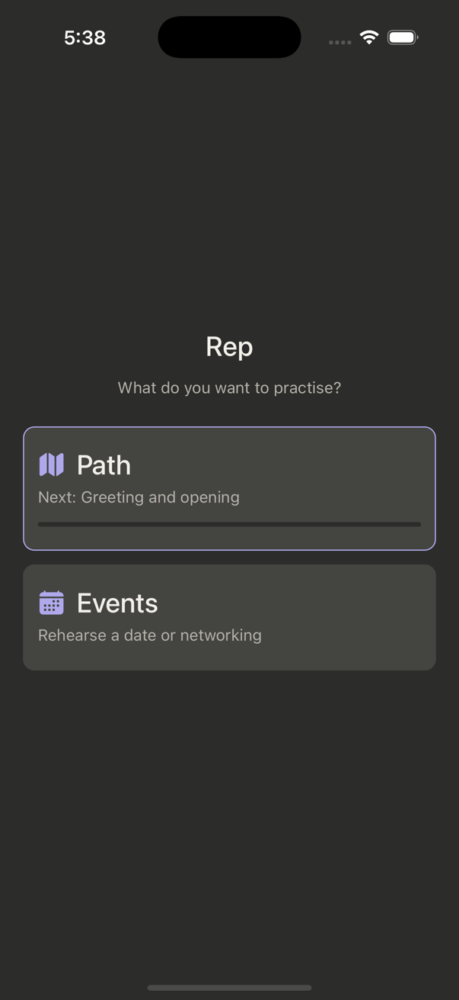
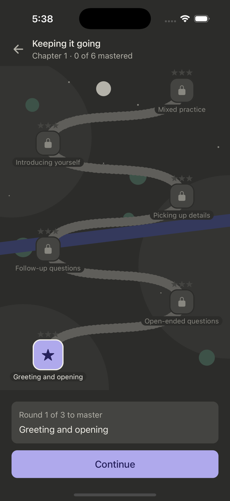
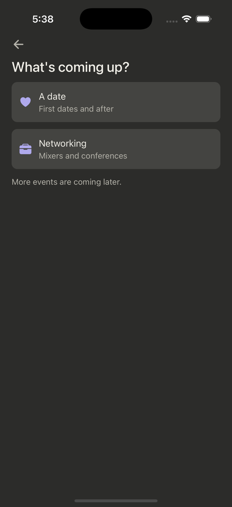
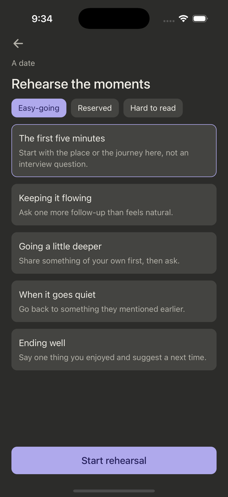
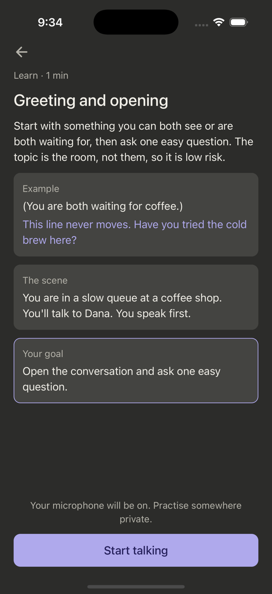
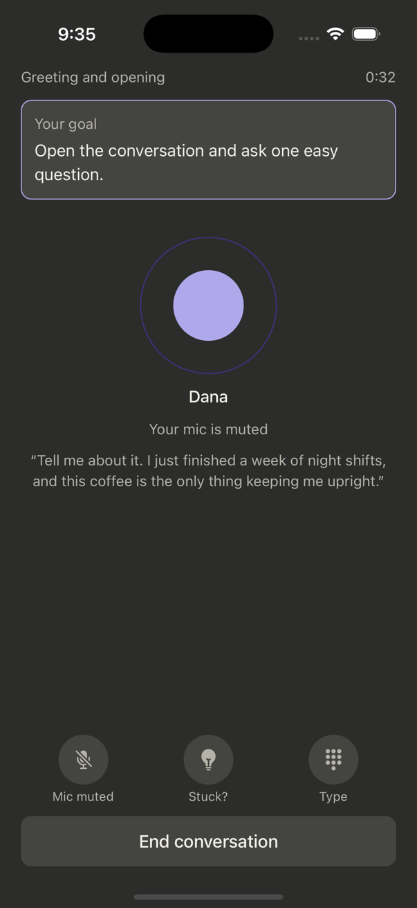
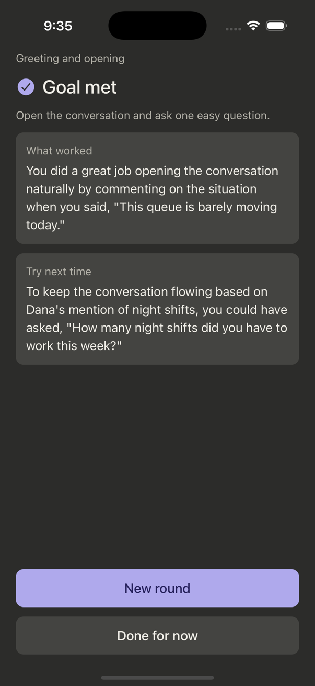
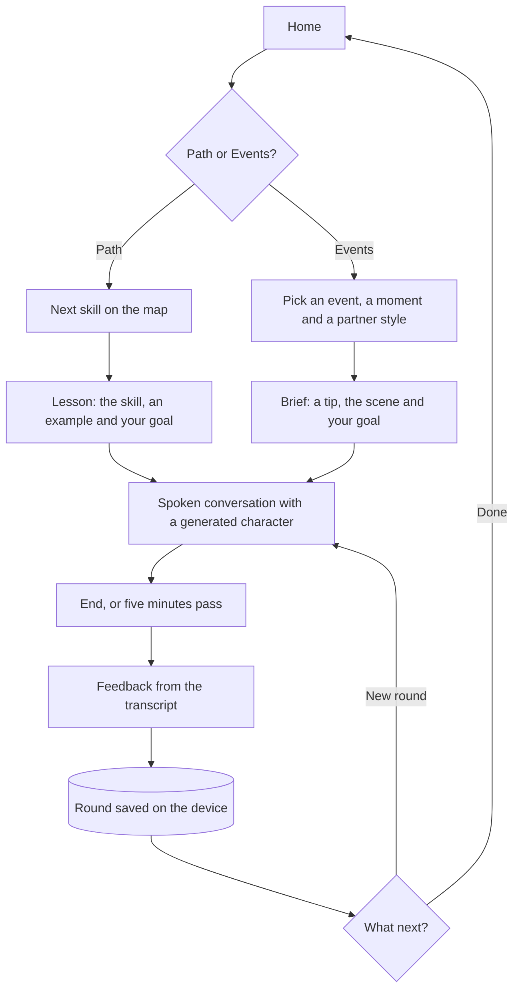
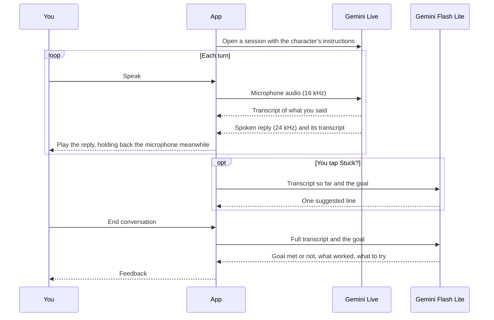

# Rep: a voice conversation gym for introverts

Rep is a mobile app for practising conversations out loud. You speak, an AI character speaks back, and the conversation carries on as it would with a real person. Each session teaches one conversational skill, has you use it in a short spoken conversation, and then tells you how it went.

"Rep" is a working name. The app is a personal project and an early first version.

## Why

Introverts usually know roughly what good conversation looks like. What is missing is a low-stakes place to rehearse it out loud, because reading advice does not build the reflex and practising on real people feels expensive when a skill is new.

The content is based on a research summary of the conversation literature: studies on talking to strangers, follow-up questions, and how people underestimate how well conversations go.

## Screens

| Home | Path | Events |
|---|---|---|
|  |  |  |

| Event moments | Lesson | Conversation |
|---|---|---|
|  |  |  |

| Feedback |
|---|
|  |

## Features

**Two ways to practise**

The app opens on two buttons, Path and Events. A back arrow in either one returns you there to switch.

- **Path.** A night map with a winding road. Each skill is a stop on the road, and they unlock in order: greeting and opening, open-ended questions, follow-up questions, picking up details, and introducing yourself. Each round in which you meet a skill's goal earns it a star, and three stars master it. After that it stays open, and your practice partner gets harder every three rounds. Each chapter ends in a mixed-practice round that never runs out.
- **Events.** Rehearsal for something coming up. Pick an event (a date or networking, so far), choose how the other person behaves (easy-going, reserved or hard to read), and rehearse one moment at a time, such as the first five minutes or leaving gracefully.

**In a conversation**

- A new character and setting are generated for every round.
- The character replies in a spoken voice, and a caption shows their last line.
- **Mic** mutes your microphone.
- **Stuck?** pauses the conversation and suggests one thing you could say.
- **Type** lets you type a line instead of speaking it.
- Your microphone audio is held back while the character is talking, so the character never reacts to its own voice.

**Afterwards**

- Feedback says whether you met the goal, quotes something you said that worked, and offers one line to try next time.
- Progress is saved on the device. There are no accounts.

## How it works



**What happens during a conversation**



## Tech stack

| Layer | Choice |
|---|---|
| App | Expo SDK 54 (React Native 0.81) with TypeScript |
| Spoken conversation | Gemini Live API (`gemini-3.8-live`) over a WebSocket |
| Feedback and "Stuck?" suggestions | Gemini Flash Lite (`gemini-3.5-flash-lite`) over REST |
| Audio capture and playback | `react-native-audio-api` |
| Progress storage | SQLite on the device (`expo-sqlite`) |
| Icons | `@expo/vector-icons` (Ionicons) |

Both Gemini models are used on the free tier. On that tier, conversations may be used by Google to improve its products.

## Repository layout

| Path | What it holds |
|---|---|
| [`rep/`](rep) | The Expo app |
| [`rep/App.tsx`](rep/App.tsx) | Screens and navigation |
| [`rep/content.ts`](rep/content.ts) | Skills, events, characters, and the logic that builds a conversation |
| [`rep/gemini.ts`](rep/gemini.ts) | The live conversation, feedback and suggestions |
| [`rep/db.ts`](rep/db.ts) | Saved progress |
| [`rep/check.ts`](rep/check.ts) | Checks for the content logic |
| [`voice-test/`](voice-test) | A one-page browser test of the Gemini Live API |

## Running it

You need a Mac with Xcode 16.1 or later, Node, CocoaPods, and a free Gemini API key from [Google AI Studio](https://aistudio.google.com/api-keys).

1. Install dependencies:

   ```bash
   cd rep && npm install
   ```

2. Create `rep/.env` with one line, using your own key. This file is ignored by Git.

   ```
   EXPO_PUBLIC_GEMINI_KEY=your-key-here
   ```

3. Build and run in the iOS simulator. The app uses native audio, so it needs a development build and does not run in Expo Go.

   ```bash
   npx expo run:ios
   ```

To run the content checks and the type-check:

```bash
node check.ts
```

```bash
npx tsc --noEmit
```

## Status and limits

This is a first version, tested in the iOS simulator only.

- The key is read by the app directly, which is fine for personal use. A shared build would need a small server in between so the key is not shipped inside the app.
- You cannot interrupt the character mid-reply, because the microphone is held back while it speaks.
- The project stays on Expo SDK 54 so that it builds with Xcode 16. A `postinstall` script patches one line of `react-native-audio-api` for the same reason.
- Android and real iPhones are untested.

Planned next: more chapters and events, feedback on how you sound (pace, volume, clarity) with short voice exercises, onboarding, and settings.

This app is practice, not treatment. If fear of conversation is stopping daily life, a professional can help.
